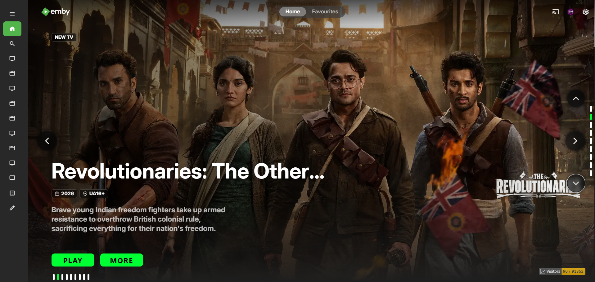
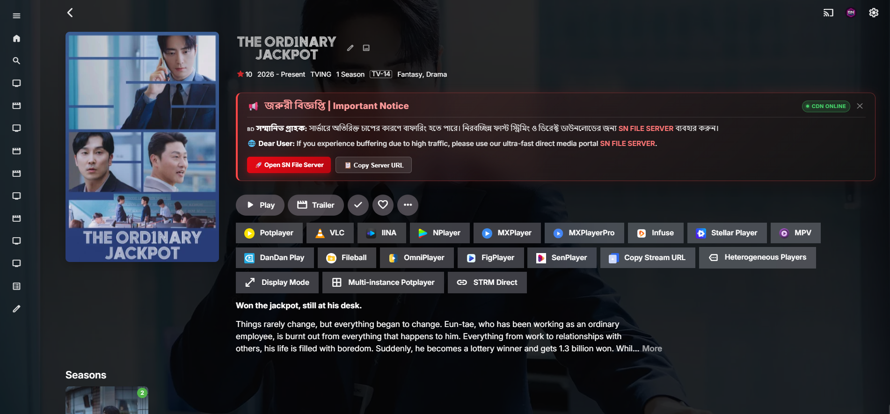
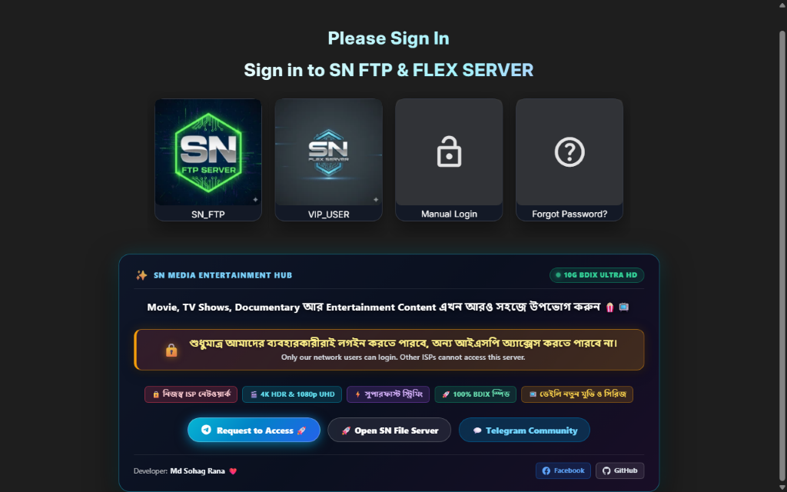
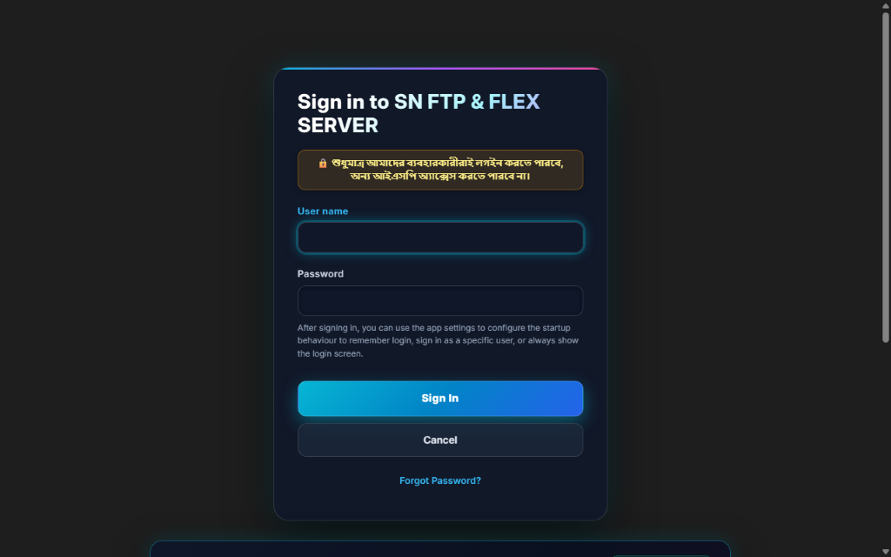

# 🚀 Emby & Jellyfin Home Swiper UI

<div align="center">

[](https://hitscounter.dev/history?url=https%3A%2F%2Fgithub.com%2Fsohag1192%2FEmby-Home-Swiper-UI)
[](https://hits.sh/github.com/sohag1192/Emby-Home-Swiper-UI/)


**Transform your Emby and Jellyfin home screen into a stunning, modern media showcase with dynamic banners, ratings, external player launching, and animated announcements.**

[✨ Features](#-key-features) • [📸 Previews](#-visual-previews) • [📂 Modules](#-repository-structure--modules) • [🛠️ Installation](#%EF%B8%8F-installation-guide) • [⚙️ Configuration](#%EF%B8%8F-customization--configuration) • [🧪 Troubleshooting](#-troubleshooting--faq) • [🔗 Related Projects](#-related-projects--ecosystem-tools) • [📬 Contact](#-contributing--contact) • [💖 Support](#-support--sponsorship) • [⭐ Star History](#-star-history)

</div>

---

## 📖 Overview

**Emby Home Swiper UI** replaces the default library grid on your Emby & Jellyfin home page (`#!/home`) with an interactive, cinematic **Swiper banner carousel**. It dynamically queries your media server's native APIs to showcase the newest, trending, and top-rated movies and TV series — with zero external library overhead for core functionality.

Beyond the home banner carousel, this all-in-one repository also provides:
- 🚀 **Modular `crx/` Suite (v2.5):** Clean, isolated extension architecture for seamless deployment.
- 🌟 **Community Ratings & Production Year Badges:** Frosted glass metadata pills with live pulsating status beacons.
- 🎬 **Cyber-Glass External Player HUD (`emby-player`):** 100% offline vector SVG icons with zero network latency, custom neon glows, and tactile copy feedback (`✅ Copied!`).
- ✍️ **Bengali Typography Support:** Google Font 'Hind Siliguri' integration with symmetrical centering and emoji wrap fixes (`🍿📺`).
- 📢 **Item Detail Announcement & Notice Boxes (`text_sider`):** Glassmorphic alert banners, rotating tickers, and VIP cards.
- 🎨 **Dedicated Jellyfin Web Theme & Carousel:** Custom theme and setup scripts for Jellyfin 10.8.x – 10.11.x+.
- ⚡ **1-Click Shell and Batch Setup Scripts:** Interactive installers for Windows, Linux, and Docker environments.

---

## 📸 Visual Previews

### 🎞️ Emby Home Swiper Carousel (V2 / V2.5)




### 🎬 External Player Integration (v2.5 Cyber-Glass HUD)


### 🎨 Emby Web Custom UI & Login Showcase



### 🍿 Jellyfin Home Carousel & Theme


### 📢 Item Detail Notice & Announcement Box (`text_sider`)


---

## ✨ Key Features

| Category | Feature | Description |
| :--- | :--- | :--- |
| 🚀 **Performance** | **Ultra-Lightweight** | Pure native JavaScript utilizing Emby/Jellyfin internal `ApiClient`. Minimal memory footprint. |
| 💎 **Cyber-Glass UI** | **v2.5 Modern HUD** | Acrylic glass cards (`rgba(15, 23, 42, 0.85)` + 20px blur) with live pulsating beacons and status chips. |
| 🖼️ **Visuals** | **High-Res Backdrops & Logos** | Automatically renders clear transparent PNG logos, backdrop fanart, taglines, and synopsis. |
| ⭐ **Metadata** | **Rating & Year Badges** | (V2/V2.5) Displays Community Rating (e.g., ⭐ 8.5/10), Production Year (e.g., 2024), and Official Content Rating (PG-13, TV-MA). |
| 🔄 **Animation** | **Auto-Slide & Pause on Hover** | Rotates slides smoothly every 6–8 seconds; automatically pauses when hovering for uninterrupted reading. |
| 📱 **Responsiveness** | **Fully Responsive Layout** | Adaptive styling seamlessly scales between 4K TVs, Ultrawide monitors, Laptops, Tablets, and Smartphones. |
| 🎯 **Navigation** | **Interactive Controls** | Next / Previous buttons, clickable pagination bullet dots, and keyboard/touch swipe navigation. |
| 🍿 **Playback** | **External Player Routing** | Launch streams straight into PotPlayer (Windows), MPV (via `mpv-handler`), VLC, IINA, and MX Player with 100% offline vector SVG icons. |
| ✍️ **Typography** | **Bangla Font Integration** | Google Font 'Hind Siliguri' support for crisp Bengali script and symmetrical layout alignment. |
| 📢 **Announcements** | **Detail Page Alert Box** | Inject customizable multilingual notice banners on media detail pages with smooth kinetic animation. |
| 🛡️ **Reliability** | **Graceful Error Handling** | Fallback backdrops, multi-event mounting retries, and error catches prevent layout breaks when metadata or fanart is missing. |

---

## 📂 Repository Structure & Modules

```text
Emby-Home-Swiper-UI/
├── crx/                         # 🚀 Modern Modular Extension Suite (Recommended v2.5)
│   ├── home.js                  # 🌟 Cinematic Swiper v2.5 (Cyber-Glass, Ratings, Year)
│   ├── README.md                # 📋 Comprehensive CRX Changelog & Technical Guide
│   ├── emby-player/             # 🎬 External Player Launcher (v2.5 Cyber-Glass HUD)
│   │   ├── emby_launch_player.js# 🎬 Launcher with 100% offline vector SVG icons
│   │   └── README.md            # 📖 Player documentation & protocol guide
│   └── img/                     # 📸 Visual and manual login preview assets
├── home-swiper-v2/              # 🌟 Advanced Swiper with Ratings, Year & UI upgrades
│   ├── home.js / home_new.js    # Latest v2.5 Swiper script
│   ├── home-swiper.js           # Clean minimalist Swiper script
│   ├── home_rating with year.js # Classic Swiper with Community Rating ⭐ & Year 📅
│   ├── README.MD                # V2 Module Documentation
│   └── img/                     # V2 Screenshots
├── home-sider-v1/               # 📦 Classic lightweight home banner slider
│   ├── home.js                  # V1 base swiper logic
│   └── img/                     # V1 Screenshots
├── emby-player/                 # 🎬 External player launcher (PotPlayer, MPV, VLC)
│   ├── emby_launch_player.js    # v2.5 Cyber-Glass HUD with offline vector SVGs
│   ├── embyLaunchPotplayer.js   # Synchronized PotPlayer script
│   └── README.md                # Player module documentation
├── Jellyfin/                    # 🍇 Dedicated Jellyfin Web integration
│   ├── jellyfin/                # Styles, main.js, jQuery & MD5 dependencies
│   ├── script.sh                # Auto setup script for Jellyfin Web
│   └── img/                     # Jellyfin Screenshots
├── text_sider/                  # 📢 Media detail page announcement & notice boxes
│   ├── Text Slider Box.html     # Scrolling notice banner
│   ├── Text No Slider Box.html  # Dual-language announcement card
│   ├── Text Aurora Glass Box.html# Aurora VIP glass card
│   ├── Text Cyber Neon Slider.html# 360° rotating neon HUD
│   ├── Text Multi-Slide Carousel.html# 3-slide notice carousel
│   ├── Text Warning Box.html    # Maintenance notice banner
│   └── demo.html                # Interactive test sandbox
├── index_integrated.html        # 🌐 Reference Emby Web index.html with clean script hooks
├── README_UPDATE.md             # 📋 Dashboard UI & typography update documentation
├── README_PACKAGE.md            # 📦 Quick CRX package instructions
├── UPDATE_SUMMARY.txt           # 📄 Full summary of UI updates and ISP alerts
├── script.sh                    # 🐧 Linux/Docker automatic installation script
├── setup-swiper.sh              # 🐧 Enhanced Linux/Docker injection script
├── download-homejs.bat          # 🪟 Windows PowerShell auto-download script
├── upload.bat                   # 🛠️ Git upload helper script
├── RELEASE_NOTES.md             # 📝 Release history and changelog
└── README.md                    # 📖 Main documentation
```

---

## 🛠️ Installation Guide

Choose your platform and preferred installation method below:

### 🌟 Option 1: Modular CRX Extension Suite (v2.5 — Recommended)

The modern **`crx/`** architecture keeps your scripts clean, isolated, and easy to maintain across server updates.

#### Step 1: Copy the `crx/` Folder
Copy the [`crx/`](crx/) folder directly into your server's `dashboard-ui/` directory:

- **Windows:** `C:\Users\<User>\AppData\Roaming\Emby-Server\system\dashboard-ui\crx\`
- **Linux (Debian / Ubuntu):** `/opt/emby-server/system/dashboard-ui/crx/`
- **Docker (`lovechen/embyserver` or official Emby Docker):** `/system/dashboard-ui/crx/`
- **Synology NAS:** `/volume1/@appstore/EmbyServer/system/dashboard-ui/crx/`

#### Step 2: Inject Script Tags in `index.html`
Open `dashboard-ui/index.html` and add these two lines immediately after `apploader.js` (or before `</body>`):

```html
<!-- Emby CRX Extensions Suite (v2.5) -->
<script src="crx/home.js" defer></script>
<script src="crx/emby-player/emby_launch_player.js" defer></script>
```

> [!TIP]
> You can also reference or copy [`index_integrated.html`](index_integrated.html) which includes pre-configured script hooks and Google Font 'Hind Siliguri' typography.

#### Step 3: Hard Refresh
Restart your Emby server or hard refresh your browser (`Ctrl + F5` on Windows/Linux or `Cmd + Shift + R` on macOS). Navigate to `#!/home`!

---

### 📦 Option 2: Classic Single Script Setup

#### Step 1: Download & Copy the Script
1. Choose your preferred script:
   - **Modern Cyber-Glass (v2.5 - Latest):** [`crx/home.js`](crx/home.js) or [`home-swiper-v2/home_new.js`](home-swiper-v2/home_new.js)
   - **Ratings & Year Edition (v2.0):** [`home-swiper-v2/home_rating with year.js`](home-swiper-v2/home_rating%20with%20year.js)
   - **Minimalist (v2.0):** [`home-swiper-v2/home-swiper.js`](home-swiper-v2/home-swiper.js)
   - **Classic (v1.0):** [`home-sider-v1/home.js`](home-sider-v1/home.js)
2. Rename the selected file to `home.js` and copy it into your `dashboard-ui/` directory.

#### Step 2: Inject the Script in `index.html`
Open `dashboard-ui/index.html` and add this tag before `</head>` or `</body>`:

```html
<!-- Emby Home Swiper UI -->
<script src="home.js" defer></script>
```

---

### ⚡ Option 3: Automated Setup (Windows & Linux)

#### Windows:
Run [`download-homejs.bat`](download-homejs.bat) from inside your server's `dashboard-ui` directory. It presents an interactive menu to select v2.5 Cyber-Glass Swiper and automatically configures `index.html`.

#### Linux / Docker:
Run the interactive setup script in your `dashboard-ui` directory:

```bash
cd /path/to/emby/system/dashboard-ui/
curl -sSL https://raw.githubusercontent.com/sohag1192/Emby-Home-Swiper-UI/main/setup-swiper.sh | bash
```

---

### 🍇 Option 4: Dedicated Jellyfin Server Installation

1. Copy the contents of the [`Jellyfin/jellyfin/`](Jellyfin/jellyfin/) directory into your Jellyfin web root folder:
   - **Linux:** `/usr/share/jellyfin/web/`
   - **Windows:** `C:\Program Files\Jellyfin\Server\jellyfin-web\`
   - **Docker:** `/jellyfin/jellyfin-web/`
2. Edit `index.html` in your Jellyfin web directory and insert before `</head>`:

```html
<!-- Jellyfin Swiper UI Assets -->
<link rel="stylesheet" id="theme-css" href="jellyfin-crx/style.css" type="text/css" media="all" />
<script src="jellyfin-crx/jquery-3.6.0.min.js"></script>
<script src="jellyfin-crx/md5.min.js"></script>
<script src="jellyfin-crx/main.js"></script>
```
3. Restart Jellyfin:
```bash
sudo systemctl restart jellyfin
```

---

### 🎬 Option 5: External Player Launcher (`emby-player`)

Route media playback directly to third-party desktop players (PotPlayer, MPV, VLC, IINA, MX Player):

1. Copy [`emby-player/emby_launch_player.js`](emby-player/emby_launch_player.js) (or [`crx/emby-player/emby_launch_player.js`](crx/emby-player/emby_launch_player.js)) into your `dashboard-ui/emby-player/` folder.
2. In `dashboard-ui/index.html`, add the following right before `</body>`:

```html
<!-- External Player Hook -->
<script src="emby-player/emby_launch_player.js" defer></script>
```

> **Requirements for External Players:**
> - **PotPlayer (Windows):** Ensure PotPlayer is installed. Soft subtitles and direct streams are supported out-of-the-box.
> - **MPV (Windows/macOS/Linux):** Requires [mpv-handler](https://github.com/akiirui/mpv-handler) protocol handler installed locally.
> - **IINA (macOS):** Requires IINA media player with URL protocol registered.

---

### 📢 Option 6: Item Detail Notice Box (`text_sider`)

To display announcement banners or server status warnings on media item detail pages (`#!/item?id=...`):

1. Open [`text_sider/Text Slider Box.html`](text_sider/Text%20Slider%20Box.html) (or `Text Aurora Glass Box.html`, `Text Warning Box.html`).
2. Copy the `<style>` and `<script>` blocks into your `dashboard-ui/index.html` right before `</body>`.
3. Customize your alert title and message text in the code as desired.

---

### 🧩 Option 7: Browser Extension (Tampermonkey / Violentmonkey)

If you do not have root/admin access to modify the server's files, you can inject the script on your client side:

1. Install **Tampermonkey** or **Violentmonkey** extension in your browser.
2. Create a new UserScript with the following header:
```javascript
// ==UserScript==
// @name         Emby Home Swiper UI
// @namespace    https://github.com/sohag1192/Emby-Home-Swiper-UI
// @version      2.5.0
// @description  A dynamic banner carousel for Emby Web
// @match        *://*/web/index.html*
// @match        *://*/*/web/index.html*
// @require      https://raw.githubusercontent.com/sohag1192/Emby-Home-Swiper-UI/main/crx/home.js
// @grant        none
// ==/UserScript==
```

---

## ⚙️ Customization & Configuration

You can easily adjust settings inside `home.js` in `class HomeSwiper.start()`:

```javascript
this.itemQuery = {
    ImageTypes: "Primary,Backdrop",
    EnableImageTypes: "Primary,Backdrop,Banner,Logo",
    IncludeItemTypes: "Movie,Series", // Filter item types (e.g. "Movie", "Series", "BoxSet")
    SortBy: "DateCreated",            // Sort order: "DateCreated", "PremiereDate", "CommunityRating", or "Random"
    SortOrder: "Descending",
    Recursive: true,
    Limit: 10,                        // Maximum number of banner slides
    Fields: "Taglines,Overview,ParentId,DateCreated,PremiereDate,ProductionYear,CommunityRating,OfficialRating,Genres,RunTimeTicks"
};

this.slideDelay = 6000;              // Slide rotation duration in milliseconds (e.g., 6000 = 6 seconds)
this.showItemNum = 10;               // Number of items to display
```

---

## 🧪 Troubleshooting & FAQ

<details>
<summary><b>1. The banner is not appearing on the home page</b></summary>

- **Check the URL Route:** The script only triggers on the home route: `#!/home`. Make sure you are on the main dashboard home page.
- **Open Developer Tools (`F12`):** Check the **Console** tab for any red errors.
- **Verify `ApiClient` Availability:**
  ```javascript
  console.log(ApiClient);
  ```
- **Manually Initialize:**
  ```javascript
  HomeSwiper.init();
  ```
</details>

<details>
<summary><b>2. Images or logos appear blank</b></summary>

- Ensure your media items have identified metadata with backdrops and clear logos in Emby.
- If an item does not have a logo, the script automatically falls back to clean styled text title.
</details>

<details>
<summary><b>3. Changes reset after server update</b></summary>

- Official server upgrades often overwrite `index.html`. Keep a backup of your script tags or use [`index_integrated.html`](index_integrated.html) to quickly restore hooks.
</details>

---

## 🔗 Related Projects & Ecosystem Tools

### 📢 [Emby to Telegram Notification Bot](https://github.com/sohag1192/emby-to-telegram)
> **Automated Telegram channel & group notification bot for newly added Emby media.**

[](https://github.com/sohag1192/emby-to-telegram)
[](https://github.com/sohag1192/emby-to-telegram)

- 🔔 **Instant Alerts:** Sends rich notifications with cover posters, movie/series plot summaries, genres, and direct stream links to Telegram.
- ⚡ **Lightweight & Python-Powered:** Easy deployment via background service or Docker with zero server overhead.

👉 **GitHub Repository:** [https://github.com/sohag1192/emby-to-telegram](https://github.com/sohag1192/emby-to-telegram)

<br/>

### 🔍 [Emby Duplicate Finder](https://github.com/sohag1192/emby-duplicate-finder)
> **Automated media library cleanup and duplicate detection tool for Emby Server.**

[](https://github.com/sohag1192/emby-duplicate-finder)
[](https://github.com/sohag1192/emby-duplicate-finder)

- 🧹 **Find Duplicate Media:** Quickly scan, identify, and report duplicate movies, series episodes, and extra video files across your Emby libraries.
- 💾 **Reclaim Storage Space:** Highlight duplicate titles across differing resolutions (e.g., 4K HDR vs 1080p SDR) and audio formats to clean up storage.
- ⚡ **Lightweight & Fast:** Direct integration with Emby Server APIs for seamless, accurate library analysis.

👉 **GitHub Repository:** [https://github.com/sohag1192/emby-duplicate-finder](https://github.com/sohag1192/emby-duplicate-finder)

---

## 🤝 Contributing & Contact

Contributions, bug reports, feature suggestions, and pull requests are welcome!  
If you find a bug or have an idea to improve the UI, feel free to open an [Issue](https://github.com/sohag1192/Emby-Home-Swiper-UI/issues) or submit a [Pull Request](https://github.com/sohag1192/Emby-Home-Swiper-UI/pulls).

<div align="center">

📬 **Email:** [sohag1192@gmail.com](mailto:sohag1192@gmail.com)  
💬 **Telegram:** [@Md_Sohag_Rana](https://t.me/Md_Sohag_Rana)

</div>

---

## 💖 **Support & Sponsorship**

<p align="center">
  <b>Hello Viewers & Developers! 🌟</b><br/>
  If you find this project, custom UI components, or media streaming scripts helpful in your own setup, here are several ways you can support continuous development, hosting, and server maintenance costs:
</p>

<br/>

<div align="center">

| Payment Method | Network / Details | Action |
| :--- | :--- | :---: |
| 💎 **Crypto (SOL / USDT / Multi-Chain)** | `9YEThZFaqmqPbPJt8f4jLxPKELMzUmgncsrqvCv44BjE` | <a href="#crypto-wallet"></a> |
| 📱 **bKash (Personal)** | Send Money (Bangladesh) — Contact on Telegram | <a href="https://t.me/Md_Sohag_Rana" target="_blank"></a> |
| ⚡ **Nagad (Personal)** | Send Money (Bangladesh) — Contact on Telegram | <a href="https://t.me/Md_Sohag_Rana" target="_blank"></a> |
| ☕ **Buy Me A Coffee** | Global Creator & Developer Support | <a href="https://rootbd.xyz" target="_blank"></a> |
| ⭐ **Star Repositories** | Free Community Support on GitHub | <a href="https://github.com/sohag1192/Emby-Home-Swiper-UI" target="_blank"></a> |

</div>

<br/>

<a id="crypto-wallet" name="crypto-wallet"></a>

### 💎 **Crypto Wallet Address (SOL / USDT / Multi-Chain):**

```bash
9YEThZFaqmqPbPJt8f4jLxPKELMzUmgncsrqvCv44BjE
```

> [!NOTE]
> 💡 *Hover over or tap the code box above and click the **Copy (📋)** button in the top-right corner to copy the wallet address instantly.*

<br/>

---

## ⭐ Star History

<div align="center">

<a href="https://star-history.com/#sohag1192/Emby-Home-Swiper-UI&Date">
 <picture>
   <source media="(prefers-color-scheme: dark)" srcset="https://api.star-history.com/svg?repos=sohag1192/Emby-Home-Swiper-UI&type=Date&theme=dark" />
   <source media="(prefers-color-scheme: light)" srcset="https://api.star-history.com/svg?repos=sohag1192/Emby-Home-Swiper-UI&type=Date" />
   
 </picture>
</a>

</div>

---

## 📜 Credits & Acknowledgments

- [Nolovenodie/emby-crx](https://github.com/Nolovenodie/emby-crx) — Original foundation and inspiration for Emby Web UI customization.
- [frostyleave/emby-crx-for-jellyfin](https://github.com/frostyleave/emby-crx-for-jellyfin) — Inspiration for Jellyfin web client adaptation.
- [bpking1/embyExternalUrl](https://github.com/bpking1/embyExternalUrl) — Foundational inspiration for the external player invocation logic.

---

## 📄 License

This project is licensed under the [MIT License](LICENSE) — free to use, modify, and distribute with attribution.
