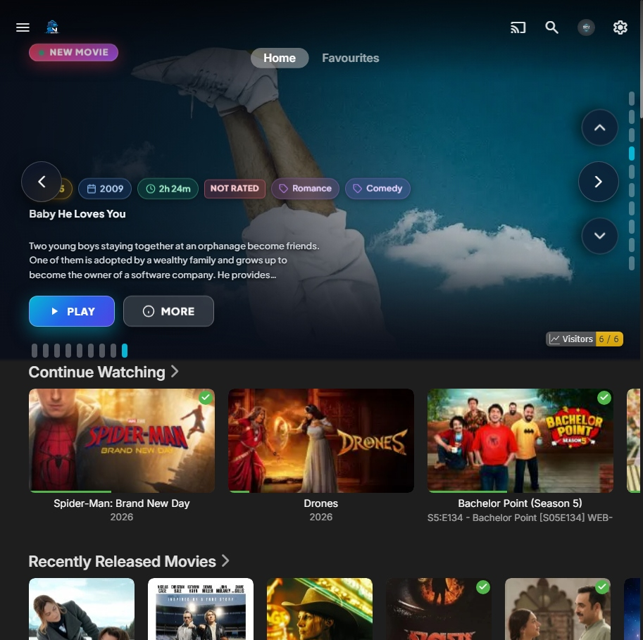

# 🚀 Emby & Jellyfin Home Swiper UI

<div align="center">

[](https://hitscounter.dev/history?url=https%3A%2F%2Fgithub.com%2Fsohag1192%2FEmby-Home-Swiper-UI)
[](https://hits.sh/github.com/sohag1192/Emby-Home-Swiper-UI/)


**Transform your Emby and Jellyfin home screen into a breathtaking, cinematic media showcase with frosted Cyber-Glass banners, live ratings, direct external player routing, and kinetic announcement HUDs.**

[✨ Highlights](#-key-features--highlights) • [📊 Feature Matrix](#-version-comparison--feature-matrix) • [📸 Preview](#-visual-preview) • [📂 Modules](#-repository-structure) • [🛠️ Installation](#%EF%B8%8F-installation-guide) • [⚙️ Configuration](#%EF%B8%8F-configuration--customization) • [🇧🇩 বাংলা গাইড](#-বাংলা-সংক্ষিপ্ত-নির্দেশিকা-bangla-quick-guide) • [🧪 FAQ](#-troubleshooting--faq) • [💖 Support](#-support--sponsorship)

</div>

---

## 📖 Overview

**Emby Home Swiper UI** replaces the default static media grid on your Emby & Jellyfin web clients (`#!/home`) with an interactive, cinematic **Swiper Hero Carousel**. It seamlessly hooks into your server's native internal API to render trending, recently added, and top-rated media with crisp fanart backdrops, transparent title logos, synopsis text, and real-time metadata pills.

Engineered with **zero external dependencies** and pure native ES6 JavaScript, it introduces zero memory leaks, loads in sub-milliseconds, and runs flawlessly across 4K Smart TVs, ultra-wide desktop monitors, tablets, and smartphones.

### 🌟 What Makes This Suite Essential:
- 💎 **Modern Cyber-Glass Aesthetics (V3):** Frosted dark acrylic cards (`rgba(15, 23, 42, 0.88)` + 20px blur), pulsing emerald beacons, glowing brand accents, and tactile hover feedback.
- ⭐ **Dynamic Ratings & Production Year Badges:** Automatically pulls and presents Community Ratings (e.g. `⭐ 8.5/10`), Release Year (e.g. `2024`), and official certification pills (`PG-13`, `TV-MA`, `R`).
- 🎬 **Zero-Transcode External Player Routing (`emby-player`):** Route streams directly to PotPlayer, MPV, VLC, IINA, and MX Player with **100% offline vector SVG icons** — eliminating server CPU/GPU transcoding bottlenecks.
- 📢 **Item Detail Announcement Suite (`text_sider`):** 6 responsive notification styles (Aurora VIP Cards, Cyber Neon Tickers, Multi-Slide Carousels, Maintenance Warning Boxes) for media detail pages (`#!/item?id=...`).
- 🍇 **Dedicated Jellyfin Web Client Support:** Tailored CSS themes, JavaScript carousel engine, and automatic setup scripts for Jellyfin 10.8.x – 10.11.x+.
- ✍️ **Bengali Typography Optimization:** Full integration for Google Font 'Hind Siliguri', fixing broken compound glyphs, symmetrical flex centering, and emoji wrap overflow.

---

## ✨ Key Features & Highlights

| Category | Feature | Benefit & Technical Implementation |
| :--- | :--- | :--- |
| 🚀 **Performance** | **Zero-Dependency Engine** | Written in lightweight ES6 vanilla JavaScript using internal `ApiClient`. No heavy jQuery or external runtime required for core Swiper banners. |
| 💎 **Design System** | **Cyber-Glass HUD** | Dual-layer backdrop masking, 20px frosted glass filter, glowing cyan borders, and ambient shadows ensure readability over any backdrop image. |
| ⭐ **Rich Metadata** | **Live Ratings & Year Pills** | Dynamically calculates and renders community ratings, production years, runtime ticks, and genre tags into elegant glass pills. |
| 🔄 **Intelligent Motion** | **Auto-Play & Smart Hover** | Smooth 6–8 second banner rotation with automatic pause on mouse hover or touch gesture for effortless synopsis reading. |
| 📱 **Responsiveness** | **Adaptive Fluid Layout** | Scales dynamically across 4K displays (2160p), Ultrawide (21:9), 1080p Laptops, iPads/Tablets, and Mobile touchscreens. |
| 🎮 **Navigation** | **Tactile Controls** | Interactive Previous / Next glass navigation buttons, synchronized bullet dot pagination, and touch swipe gestures. |
| 🍿 **Playback** | **Native Desktop Launchers** | Bypasses browser codec limits (Direct 4K HDR10+, Dolby Vision Profile 5/8, TrueHD Atmos, ASS subtitles) straight into native media players. |
| ⚡ **Offline SVGs** | **Zero Network Latency** | Player brand icons (PotPlayer, VLC, MPV, IINA, MX Player) are embedded directly as crisp vector SVG data URIs. |
| 🛡️ **Reliability** | **Multi-Event Mounting Retry** | Listens to `viewshow`, `pageshow`, and route change events with automated fail-safes against race conditions with `apploader.js`. |

---

## 📊 Version Comparison & Feature Matrix

| Feature / Capability | Emby Default | Home Slider V1 | Home Swiper V2 | Home Swiper V3 (Cyber-Glass) |
| :--- | :---: | :---: | :---: | :---: |
| **High-Res Fanart Backdrops** | ❌ Static Posters | ✅ Full Width | ✅ Enhanced Contrast | ✅ Triple Gradient Masking |
| **Clear PNG Title Logos** | ❌ Plain Text | ✅ Supported | ✅ Supported | ✅ Auto-Fallback to Styled Text |
| **Community Rating Badges (⭐)** | ❌ Small Text | ❌ None | ✅ Classic Pill | ✅ Frosted Glass + Ambient Glow |
| **Production Year Metadata (📅)**| ❌ Plain Info | ❌ None | ✅ Classic Pill | ✅ Violet Glass Tag |
| **Official Content Rating Pills**| ❌ Small Info | ❌ None | ✅ Classic Pill | ✅ Neon Border Tag |
| **External Player HUD Integration**| ❌ Browser Player Only| ❌ None | ⚠️ Basic Buttons | ✅ Cyber-Glass HUD + Offline SVGs |
| **Pulsating Live Status Beacons** | ❌ None | ❌ None | ❌ None | ✅ Emerald Glow Beacon |
| **Multi-Event Mounting Retry** | ❌ None | ⚠️ Single Event | ⚠️ Basic Retry | ✅ Automated Fail-Safe Loop |
| **Google Font 'Hind Siliguri'** | ❌ System Default | ❌ None | ❌ None | ✅ Native Bengali Font Stack |

---

## 📸 Visual Preview

<div align="center">



</div>

---

## 📂 Repository Structure

```text
Emby-Home-Swiper-UI/
├── home-swiper-v3/              # 🚀 Latest Swiper v3 (Cyber-Glass, Ratings, Year, Beacons)
│   ├── home.js                  # 🌟 Production Swiper v3 script
│   └── README.md                # 📖 V3 documentation & setup
├── home-swiper-v2/              # 🌟 Swiper v2 with Ratings, Year & UI upgrades
│   ├── home-swiper.js           # 🌟 Enhanced Swiper v2 script (Frosted glass & Dual Actions)
│   ├── home_rating with year.js # ⭐ Classic Swiper with Community Rating & Year
│   ├── home-swiper-v1.js        # ⚡ Clean minimalist lightweight Swiper script
│   └── README.md                # 📖 V2 documentation & setup
├── home-sider-v1/               # 📦 Classic lightweight home banner slider
│   └── home.js                  # V1 base swiper logic
├── emby-player/                 # 🎬 External player launcher (PotPlayer, MPV, VLC)
│   ├── v1/                      # v1 classic player scripts
│   │   └── emby_launch_player.js
│   └── v2/                      # v2 Cyber-Glass HUD launcher with offline vector SVGs
│       └── emby_launch_player.js
├── Jellyfin/                    # 🍇 Dedicated Jellyfin Web integration
│   ├── jellyfin/                # Styles, main.js, jQuery, MD5 & logo assets
│   └── script.sh                # Auto setup script for Jellyfin Web
├── text_sider/                  # 📢 Media detail page announcement & notice boxes
│   ├── Text Slider Box.html     # Continuous scrolling marquee ticker
│   ├── Text No Slider Box.html  # Dual-language glass announcement card
│   ├── Text Aurora Glass Box.html# Aurora VIP glass card with ambient glow
│   ├── Text Cyber Neon Slider.html# 360° rotating neon HUD marquee
│   ├── Text Multi-Slide Carousel.html# 3-slide interactive notice carousel
│   ├── Text Warning Box.html    # Maintenance notice banner
│   └── demo.html                # Interactive test sandbox with 1-click code copying
├── screenshots/                 # 📸 Clean UI preview screenshot
│   └── screenshot1.png
├── index_integrated.html        # 🌐 Reference Emby Web index.html with clean script hooks
├── download-homejs.bat          # 🪟 Windows PowerShell interactive setup script
├── setup-swiper.sh              # 🐧 Linux/Docker interactive setup script
├── upload.bat                   # 🛠️ Git upload helper script
├── RELEASE_NOTES.md             # 📝 Detailed release history & changelog
├── LICENSE                      # 📄 MIT License
└── README.md                    # 📖 Master documentation
```

---

## 🛠️ Installation Guide

Select your target server platform and preferred installation approach:

### 🌟 Option 1: Emby Server Manual Installation (Recommended)

#### Step 1: Locate your Emby Web `dashboard-ui` directory
Locate the web root folder for your operating system:

| Operating System / Container | Standard Path to `dashboard-ui` |
| :--- | :--- |
| 🪟 **Windows Server / Desktop** | `C:\Users\<User>\AppData\Roaming\Emby-Server\system\dashboard-ui\` |
| 🐧 **Linux (Debian / Ubuntu)** | `/opt/emby-server/system/dashboard-ui/` |
| 🐳 **Docker (`official` / `lovechen`)** | `/system/dashboard-ui/` *(or locate via container volume mount)* |
| 💾 **Synology NAS** | `/volume1/@appstore/EmbyServer/system/dashboard-ui/` |
| 📦 **QNAP NAS** | `/share/CACHEDEV1_DATA/.qpkg/EmbyServer/system/dashboard-ui/` |
| ⚡ **Unraid / TrueNAS** | AppData path mapped to `/system/dashboard-ui/` |

#### Step 2: Choose and Copy Your Banner Script
1. Pick your preferred version:
   - **Version 3 Cyber-Glass (Latest - Recommended):** [`home-swiper-v3/home.js`](home-swiper-v3/home.js)
   - **Version 2 Enhanced:** [`home-swiper-v2/home-swiper.js`](home-swiper-v2/home-swiper.js)
   - **Version 2 with Ratings & Year:** [`home-swiper-v2/home_rating with year.js`](home-swiper-v2/home_rating%20with%20year.js)
   - **Version 2 Minimalist Swiper:** [`home-swiper-v2/home-swiper-v1.js`](home-swiper-v2/home-swiper-v1.js)
   - **Version 1 Classic Slider:** [`home-sider-v1/home.js`](home-sider-v1/home.js)
2. Place the file into your `dashboard-ui/` folder as `home.js` (or in a subfolder like `dashboard-ui/crx/home.js`).

#### Step 3: Inject the Script in `dashboard-ui/index.html`
Open `dashboard-ui/index.html` with your code editor and add the script tag right after `apploader.js` (or before `</body>`):

```html
<!-- Emby Home Swiper UI -->
<script src="home.js" defer></script>
```
*(If stored inside `crx/home.js`, use `<script src="crx/home.js" defer></script>`)*

> [!TIP]
> You can also reference [`index_integrated.html`](index_integrated.html) which includes pre-configured script hooks, Google Font 'Hind Siliguri', and optimized login styling.

#### Step 4: Hard Refresh
Restart your Emby server or perform a hard refresh in your browser (`Ctrl + F5` on Windows/Linux or `Cmd + Shift + R` on macOS). Open `#!/home` to enjoy!

---

### ⚡ Option 2: Automated 1-Click Installation (Windows & Linux)

#### 🪟 Windows Setup Script:
1. Place [`download-homejs.bat`](download-homejs.bat) inside your Emby `dashboard-ui` directory.
2. Double-click to run. Choose your desired version from the interactive menu:
   - `[1] Version 3 - Cyber-Glass Swiper (Latest - Recommended)`
   - `[2] Version 2 - With Ratings ⭐ and Release Year 📅`
   - `[3] Version 2 - Clean Minimal Swiper`
   - `[4] Version 1 - Classic Lightweight Slider`
3. The script automatically downloads the script and safely injects it into `index.html`.

#### 🐧 Linux / Docker Automated Script:
Run the following interactive installer inside your server terminal:

```bash
cd /path/to/emby/system/dashboard-ui/
curl -sSL https://raw.githubusercontent.com/sohag1192/Emby-Home-Swiper-UI/main/setup-swiper.sh | bash
```

---

### 🎬 Option 3: External Player Launcher (`emby-player/v2`)

Intercept browser playback clicks and stream directly into high-performance desktop players:

| Player | Platform | Supported Protocols | Key Feature |
| :--- | :--- | :--- | :--- |
| **PotPlayer** | 🪟 Windows | `potplayer://` | Full external soft-subtitle auto-load, custom pixel shaders, multi-audio. |
| **MPV** | 🪟 Win / 🐧 Linux / 🍎 Mac | Protocol via [mpv-handler](https://github.com/akiirui/mpv-handler) | Minimalist, scriptable, zero overhead, Anime 4K upscaling. |
| **VLC Media Player**| 🌐 Universal | `vlc://` | Unrivaled cross-platform compatibility. |
| **IINA** | 🍎 macOS | `iina://weblink` | Polished native modern macOS player with Touch Bar integration. |
| **MX Player / nPlayer** | 📱 Android / iOS | Mobile intent & URL scheme | Direct hardware decoding on mobile devices. |

#### Setup:
1. Copy [`emby-player/v2/emby_launch_player.js`](emby-player/v2/emby_launch_player.js) into your `dashboard-ui/emby-player/` folder.
2. In `dashboard-ui/index.html`, add this line before `</body>`:

```html
<!-- External Player Cyber-Glass HUD -->
<script src="emby-player/emby_launch_player.js" defer></script>
```

---

### 📢 Option 4: Item Detail Notice Box Suite (`text_sider`)

To display announcement banners, BDIX file server links, or Telegram requests on media detail pages (`#!/item?id=...`):

1. Choose a template from [`text_sider/`](text_sider/):
   - **`Text Aurora Glass Box.html`**: Flowing ambient mesh gradient, live shimmer bar, and VIP action buttons.
   - **`Text Cyber Neon Slider.html`**: Cyberpunk aesthetic with 360° neon border and animated soundwave equalizer.
   - **`Text Multi-Slide Carousel.html`**: 3-slide interactive notice carousel (CDN, IDM Download, Telegram Request) with progress timer.
   - **`Text No Slider Box.html`**: Dual-language (Bangla + English) frosted glass notice card.
   - **`Text Slider Box.html`**: Continuous horizontal marquee ticker with pause-on-hover.
   - **`Text Warning Box.html`**: Compact high-visibility maintenance alert banner.
2. Open the `.html` file, copy the `<style>` and `<script>` blocks, and paste them before `</body>` in `dashboard-ui/index.html`.
3. Test and preview all 6 templates in the interactive sandbox: [`text_sider/demo.html`](text_sider/demo.html).

---

### 🍇 Option 5: Dedicated Jellyfin Server Installation

1. Copy the contents of the [`Jellyfin/jellyfin/`](Jellyfin/jellyfin/) directory into your Jellyfin web root folder:
   - **Linux:** `/usr/share/jellyfin/web/`
   - **Windows:** `C:\Program Files\Jellyfin\Server\jellyfin-web\`
   - **Docker:** `/jellyfin/jellyfin-web/`
2. Open `index.html` in your Jellyfin web root and add before `</head>`:

```html
<!-- Jellyfin Swiper UI Assets -->
<link rel="stylesheet" id="theme-css" href="jellyfin-crx/style.css" type="text/css" media="all" />
<script src="jellyfin-crx/jquery-3.6.0.min.js"></script>
<script src="jellyfin-crx/md5.min.js"></script>
<script src="jellyfin-crx/main.js"></script>
```
3. Restart Jellyfin: `sudo systemctl restart jellyfin`.

---

### 🧩 Option 6: Client-Side UserScript (Tampermonkey / Violentmonkey)

If you do not have administrative access to the server's files, inject the script locally in your browser:

1. Install [Tampermonkey](https://www.tampermonkey.net/) or Violentmonkey in Chrome, Edge, Firefox, or Safari.
2. Create a new UserScript with the following header:

```javascript
// ==UserScript==
// @name         Emby Home Swiper UI (V3 Cyber-Glass)
// @namespace    https://github.com/sohag1192/Emby-Home-Swiper-UI
// @version      3.0.0
// @description  Cinematic Home Swiper Carousel for Emby Web
// @match        *://*/web/index.html*
// @match        *://*/*/web/index.html*
// @require      https://raw.githubusercontent.com/sohag1192/Emby-Home-Swiper-UI/main/home-swiper-v3/home.js
// @grant        none
// ==/UserScript==
```

---

## ⚙️ Configuration & Customization

You can fine-tune query parameters, slide intervals, and image sizes directly inside `home.js` under `class HomeSwiper.start()`:

```javascript
this.itemQuery = { 
    ImageTypes: "Primary,Backdrop", 
    EnableImageTypes: "Primary,Backdrop,Banner,Logo", 
    IncludeItemTypes: "Movie,Series", // Filter item types: "Movie", "Series", "BoxSet"
    SortBy: "DateCreated",            // Sorting: "DateCreated", "PremiereDate", "CommunityRating", "Random"
    SortOrder: "Descending",          // "Descending" (newest first) or "Ascending"
    Recursive: true, 
    ImageTypeLimit: 1, 
    Limit: 10,                        // Maximum items fetched from your library
    Fields: "Taglines,Overview,ParentId,DateCreated,PremiereDate,ProductionYear,CommunityRating,OfficialRating,Genres,RunTimeTicks", 
    EnableUserData: true, 
    EnableTotalRecordCount: false 
};

this.slideDelay = 6000;  // Auto-slide rotation delay in milliseconds (6000 = 6 seconds)
this.showItemNum = 10;   // Number of banner slides in rotation
```

### 💡 Common Query Presets:

- **⭐ Top-Rated Showcase:**
  ```javascript
  SortBy: "CommunityRating",
  SortOrder: "Descending",
  ```
- **📅 Newest Premiere Date:**
  ```javascript
  SortBy: "PremiereDate",
  SortOrder: "Descending",
  ```
- **🎲 Random Discovery Shuffle:**
  ```javascript
  SortBy: "Random",
  ```

---

## 🇧🇩 বাংলা সংক্ষিপ্ত নির্দেশিকা (Bangla Quick Guide)

<details>
<summary><b>📌 Emby ও Jellyfin সার্ভারে বাংলায় সেটআপ নির্দেশিকা দেখতে এখানে ক্লিক করুন</b></summary>

### ১. মূল বৈশিষ্ট্যসমূহ:
- **সিনেমাটিক হোম ব্যানার (Home Swiper V3):** সার্ভারের নতুন এবং ট্রেন্ডিং মুভি/সিরিজ স্বয়ংক্রিয়ভাবে হোম পেজে বড় ব্যানার আকারে স্লাইড করবে।
- **রেটিং ও রিলিজ ইয়ার:** প্রতিটি ব্যানারের উপর কমিউনিটি রেটিং (`⭐ 8.5/10`), রিলিজ সাল ও কনটেন্ট রেটিং প্রদর্শিত হবে।
- **এক্সটার্নাল প্লেয়ার সাপোর্ট (PotPlayer, VLC, MPV):** ব্রাউজারের প্লেয়ারে 4K HDR বা বড় ফাইল বাফারিং ও ট্রান্সকোডিং ছাড়াই সরাসরি পিসির পটলিপ্লেয়ার বা ভিএলসিতে জিরো ল্যাটেন্সিতে চলবে।
- **আইটেম ডিটেইল নোটিশ বক্স (`text_sider`):** মুভি বা সিরিজের ডিটেইল পেজে প্লে বাটনের নিচে নোটিশ বা আপনার নিজস্ব ফাইল সার্ভার লিংক প্রদর্শিত হবে।

### ২. দ্রুত ইনস্টলেশন:
1. আপনার Emby সার্ভারের `dashboard-ui/` ফোল্ডারে প্রবেশ করুন।
2. [`home-swiper-v3/home.js`](home-swiper-v3/home.js) ফাইলটি ডাউনলোড করে `dashboard-ui/home.js` হিসেবে সেভ করুন।
3. `dashboard-ui/index.html` ফাইলের একদম নিচে `</body>` ট্যাগের ঠিক আগে নিচের কোডটি যুক্ত করুন:
   ```html
   <script src="home.js" defer></script>
   ```
4. ব্রাউজারে গিয়ে **Ctrl + F5** চেপে হার্ড রিফ্রেশ করুন এবং `#!/home` পেজে প্রবেশ করুন।

</details>

---

## 🧪 Troubleshooting & FAQ

<details>
<summary><b>1. The banner is not displaying on the home page</b></summary>

- **Verify Route:** The script only triggers on the main home screen: `#!/home`.
- **Check Developer Console (`F12`):** Check the Console tab for any red JavaScript errors.
- **Verify `ApiClient`:** In your browser console, type `console.log(ApiClient);`. If it returns `undefined`, make sure your `<script>` tag has the `defer` attribute and is loaded after `apploader.js`.
- **Manual Launch Test:** Execute manually in console:
  ```javascript
  HomeSwiper.init();
  ```
</details>

<details>
<summary><b>2. Fanart or title logos appear blank</b></summary>

- Ensure your media items have identified metadata with valid backdrops and transparent PNG logos in Emby.
- If an item does not have a transparent logo, the script automatically falls back to a stylized typographic title.
</details>

<details>
<summary><b>3. Changes reset after an official Emby Server update</b></summary>

- Official server upgrades often overwrite `index.html`. Keep a backup of your script tags or use [`index_integrated.html`](index_integrated.html) to quickly restore your script hooks.
</details>

---

## 🔗 Related Projects & Ecosystem Tools

### 📢 [Emby to Telegram Notification Bot](https://github.com/sohag1192/emby-to-telegram)
> **Automated Telegram channel & group notification bot for newly added Emby media.**

[](https://github.com/sohag1192/emby-to-telegram)
[](https://github.com/sohag1192/emby-to-telegram)

- 🔔 **Instant Alerts:** Sends rich notifications with cover posters, movie/series plot summaries, genres, and direct stream links to Telegram.
- ⚡ **Lightweight & Python-Powered:** Easy deployment via background service or Docker with zero server overhead.

👉 **GitHub Repository:** [https://github.com/sohag1192/emby-to-telegram](https://github.com/sohag1192/emby-to-telegram)

<br/>

### 🔍 [Emby Duplicate Finder](https://github.com/sohag1192/emby-duplicate-finder)
> **Automated media library cleanup and duplicate detection tool for Emby Server.**

[](https://github.com/sohag1192/emby-duplicate-finder)
[](https://github.com/sohag1192/emby-duplicate-finder)

- 🧹 **Find Duplicate Media:** Quickly scan, identify, and report duplicate movies, series episodes, and extra video files across your Emby libraries.
- 💾 **Reclaim Storage Space:** Highlight duplicate titles across differing resolutions (e.g., 4K HDR vs 1080p SDR) and audio formats to clean up storage.
- ⚡ **Lightweight & Fast:** Direct integration with Emby Server APIs for seamless, accurate library analysis.

👉 **GitHub Repository:** [https://github.com/sohag1192/emby-duplicate-finder](https://github.com/sohag1192/emby-duplicate-finder)

---

## 🤝 Contributing & Contact

Contributions, bug reports, feature suggestions, and pull requests are welcome!  
If you find a bug or have an idea to improve the UI, feel free to open an [Issue](https://github.com/sohag1192/Emby-Home-Swiper-UI/issues) or submit a [Pull Request](https://github.com/sohag1192/Emby-Home-Swiper-UI/pulls).

<div align="center">

📬 **Email:** [sohag1192@gmail.com](mailto:sohag1192@gmail.com)  
💬 **Telegram:** [@Md_Sohag_Rana](https://t.me/Md_Sohag_Rana)

</div>

---

## 💖 **Support & Sponsorship**

<p align="center">
  <b>Hello Viewers & Developers! 🌟</b><br/>
  If you find this project, custom UI components, or media streaming scripts helpful in your own setup, here are several ways you can support continuous development, hosting, and server maintenance costs:
</p>

<br/>

<div align="center">

| Payment Method | Network / Details | Action |
| :--- | :--- | :---: |
| 💎 **Crypto (SOL / USDT / Multi-Chain)** | `9YEThZFaqmqPbPJt8f4jLxPKELMzUmgncsrqvCv44BjE` | <a href="#crypto-wallet"></a> |
| 📱 **bKash (Personal)** | Send Money (Bangladesh) — Contact on Telegram | <a href="https://t.me/Md_Sohag_Rana" target="_blank"></a> |
| ⚡ **Nagad (Personal)** | Send Money (Bangladesh) — Contact on Telegram | <a href="https://t.me/Md_Sohag_Rana" target="_blank"></a> |
| ☕ **Buy Me A Coffee** | Global Creator & Developer Support | <a href="https://rootbd.xyz" target="_blank"></a> |
| ⭐ **Star Repositories** | Free Community Support on GitHub | <a href="https://github.com/sohag1192/Emby-Home-Swiper-UI" target="_blank"></a> |

</div>

<br/>

<a id="crypto-wallet" name="crypto-wallet"></a>

### 💎 **Crypto Wallet Address (SOL / USDT / Multi-Chain):**

```bash
9YEThZFaqmqPbPJt8f4jLxPKELMzUmgncsrqvCv44BjE
```

> [!NOTE]
> 💡 *Hover over or tap the code box above and click the **Copy (📋)** button in the top-right corner to copy the wallet address instantly.*

<br/>

---

## ⭐ Star History

<div align="center">

<a href="https://star-history.com/#sohag1192/Emby-Home-Swiper-UI&Date">
 <picture>
   <source media="(prefers-color-scheme: dark)" srcset="https://api.star-history.com/svg?repos=sohag1192/Emby-Home-Swiper-UI&type=Date&theme=dark" />
   <source media="(prefers-color-scheme: light)" srcset="https://api.star-history.com/svg?repos=sohag1192/Emby-Home-Swiper-UI&type=Date" />
   
 </picture>
</a>

</div>

---

## 📜 Credits & Acknowledgments

- [Nolovenodie/emby-crx](https://github.com/Nolovenodie/emby-crx) — Original foundation and inspiration for Emby Web UI customization.
- [frostyleave/emby-crx-for-jellyfin](https://github.com/frostyleave/emby-crx-for-jellyfin) — Inspiration for Jellyfin web client adaptation.
- [bpking1/embyExternalUrl](https://github.com/bpking1/embyExternalUrl) — Foundational inspiration for the external player invocation logic.

---

## 📄 License

This project is licensed under the [MIT License](LICENSE) — free to use, modify, and distribute with attribution.
