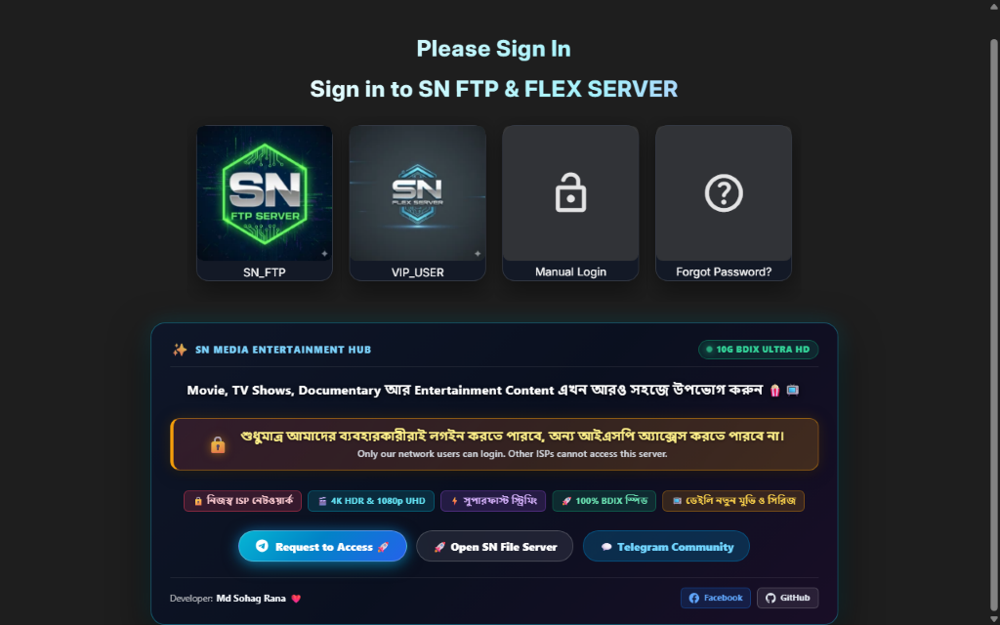
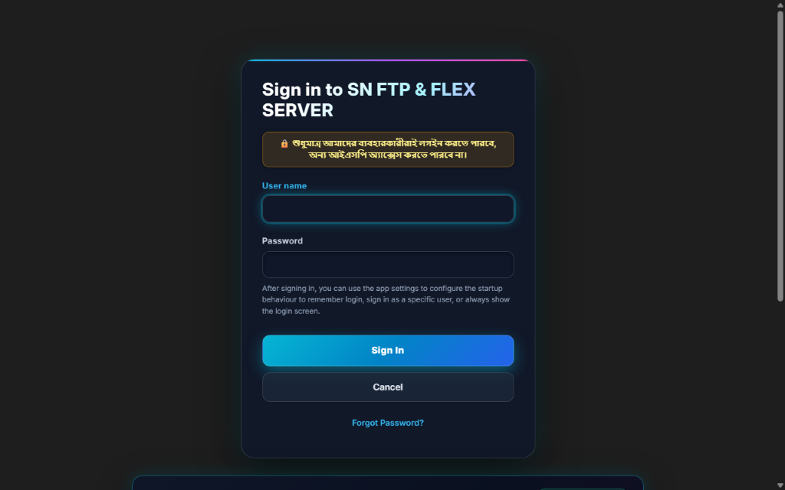

# 🚀 Emby CRX Extensions — Update Log & Documentation
> **Server:** Sarker Net / SN Media Services  
> **Directory:** `c:\Users\Sarker_Net\AppData\Roaming\Emby-Server\system\dashboard-ui\crx\`  
> **Latest Update Date:** 19 November 2026  
> **Author & Developer:** Md Sohag Rana ❤️  

---

## 📌 ১. ওভারভিউ (Overview)
`crx` ফোল্ডারটি Emby Web ক্লায়েন্টের জন্য একটি কাস্টম এক্সটেনশন ও অ্যাড-অন স্যুট। এটি সার্ভারের ওয়েব ইন্টারফেসে আধুনিক সিনেমাটিক হোম ব্যানার ক্যারোজেল, রেটিং ব্যাজ এবং এক্সটার্নাল প্লেয়ার ইন্টিগ্রেশন (PotPlayer, VLC, MPV ইত্যাদি) যুক্ত করে।

---

## 📂 ২. বর্তমান ক্লিন ফোল্ডার স্ট্রাকচার (Clean Architecture)
```text
dashboard-ui/crx/
├── emby-player/
│   ├── emby_launch_player.js       # 🎬 আপডেটেড এক্সটার্নাল প্লেয়ার স্ক্রিপ্ট (Zero Transcode HUD)
│   └── README.md                   # প্লেয়ার সংক্রান্ত ডকুমেন্টেশন ও প্রোটোকল গাইড
├── home.js                         # 🌟 প্রিমিয়াম হোম ব্যানার ক্যারোজেল স্ক্রিপ্ট (Home Swiper V2)
└── README.md                       # 📋 এই চেঞ্জলগ ও ডকুমেন্টেশন ফাইল
```

---

## 🛠️ ৩. কি কি পরিবর্তন ও আপডেট হয়েছে (Summary of Updates & Changes)

### ক. অপ্রয়োজনীয় ফাইল ক্লিনআপ (Cleanup & Optimization)
- ❌ **`crx\home-sider-v1\` রিমুভ:** পুরনো ভার্সন ১ স্লাইডারটি মুছে ফেলা হয়েছে।
- ❌ **`crx\home-swiper-v2\` রিমুভ:** অপ্রয়োজনীয় ডেমো ও আনইউজড সোর্স ফোল্ডার সম্পূর্ণ ক্লিন করা হয়েছে।
- ❌ **`crx\text_sider\` রিমুভ:** যেহেতু এর মূল কোড পূর্বেই `index.html`-এ ইনজেক্ট করা ছিল এবং এটি লাইভ সার্ভারে আলাদাভাবে কল হচ্ছিল না, তাই ফোল্ডারটি রিমুভ করা হয়েছে।
- ❌ **`home.js.bak` ও স্ক্রিনশট রিমুভ:** অপ্রয়োজনীয় ডুপ্লিকেট ব্যাকআপ এবং ভারী `.png` ইমেজ ক্লিন করা হয়েছে।
- 🛡️ **সম্পূর্ণ ব্যাকআপ সংরক্ষণ:** মুছে ফেলা সব ফাইলের একটি মূল কপি নিরাপদে সংরক্ষণ করা হয়েছে:  
  `dashboard-ui\crx_backup_original\`

---

### খ. স্ক্রিপ্ট ইনজেকশন ও অর্ডার ফিক্স (`index.html`)
1. **হেডার থেকে বডিতে স্থানান্তর:**  
   - পূর্বে `<head>` এর মধ্যে `<script src="crx/home.js"></script>` রাখা ছিল। Emby-এর মূল আর্কিটেকচার অনুযায়ী `apploader.js` লোড হওয়ার আগেই এটি রান হতো, যার ফলে মাঝে মাঝে `ApiClient` রেইস কন্ডিশন তৈরি হতো।
   - এখন `crx/home.js` ফাইলটিকে `apploader.js`-এর ঠিক পরে `<body>` ট্যাগের মধ্যে `defer` অ্যাট্রিবিউট সহ যুক্ত করা হয়েছে।
2. **ডিরেক্ট `crx` পাথে সুইচ:**  
   - এক্সটার্নাল প্লেয়ার স্ক্রিপ্টটি পুরনো পাথ `emby-player/embyLaunchPotplayer.js` থেকে সরিয়ে সরাসরি নতুন **`crx/emby-player/emby_launch_player.js`** থেকে লোড করা হচ্ছে।
3. **মাল্টি-ইভেন্ট মাউন্টিং রিট্রাই (Mounting Reliability):**  
   - `crx/home.js`-এ `viewshow` ইভেন্টে অটোমেটিক সিকিউর রিট্রাই যোগ করা হয়েছে, যাতে ইউজার লগইন করার সাথে সাথে ব্যানারটি কোনো ধরনের ফ্লিকার ছাড়া লোড হয়।

---

### গ. হোম ব্যানার ক্যারোজেল UI ও UX আপগ্রেড (`crx/home.js`)
1. **সিনেমা-গ্রেড অ্যাম্বিয়েন্ট মাস্ক (Cinematic Ambient Mask):**  
   - ব্যানারের চারপাশের ট্রানজিশন গ্রেডিয়েন্ট আরও ডিপ করা হয়েছে (3-way ambient occlusion vignette), যাতে টাইটেল এবং তথ্য স্পষ্ট থাকে এবং পেজের ব্যাকগ্রাউন্ডের সাথে নিরবচ্ছিন্নভাবে মিশে যায়।
2. **লাইভ স্ট্যাটাস বিকন (Live Pulsing Beacon):**  
   - ব্যানারের শীর্ষ ব্যাজে (`FEATURED MOVIE` / `TV SERIES`) একটি অ্যানিমেটেড সবুজ পালসিং বিকন যুক্ত করা হয়েছে।
3. **ফ্রস্টেড গ্লাস মেটাডাটা চিপস (Frosted Glass Metadata Chips):**  
   - ⭐ **রেটিং ব্যাজ:** গোল্ডেন গ্লো এবং অ্যাম্বার ফ্রস্টেড কার্ড (`#facc15`)।  
   - 📅 **রিলিজ বছর:** ইন্ডিগো গ্লাস ব্যাজ (`#c7d2fe`)।  
   - ⏱️ **ডিউরেশন:** টিল গ্লাস ব্যাজ (`#99f6e4`)।  
   - 🛡️ **সার্টিফিকেশন:** রোজ গ্লাস ব্যাজ (`#fecdd3`)।  
   - প্রতিটি চিপে স্মুথ হোভার এলিভেশন এবং বর্ডার লাইটিং যুক্ত করা হয়েছে।
4. **মডার্ন অ্যাকশন বাটনস (Play & More Info):**  
   - **`PLAY` বাটন:** ভাইব্রেন্ট সায়ান-টু-ইন্ডিগো গ্রেডিয়েন্ট (`linear-gradient(135deg, #06b6d4, #2563eb, #4f46e5)`) উইথ ৩ডি এলিভেশন ও নিয়ন শ্যাডো।
   - **`MORE INFO` বাটন:** অ্যাক্রিলিক ফ্রস্টেড গ্লাস উইথ হোভার বর্ডার গ্লো।
5. **ন্যাভিগেশন ও থাম্বনেইল:**  
   - পেজিনেশন বুলেটগুলোকে গ্লোয়িং ক্যাপসুল ডিজাইন করা হয়েছে।
   - প্রিভিউ/নেক্সট অ্যারো বোতামগুলোকে ফ্লোটিং গ্লাস স্টাইলে আপগ্রেড করা হয়েছে।
   - থাম্বনেইল কার্ডের হোভার ও একটিভ বর্ডার আরও শার্প ও রেসপনসিভ করা হয়েছে।

---

### ঘ. এক্সটার্নাল প্লেয়ার ইন্টিগ্রেশন UI ও UX আপগ্রেড (`crx/emby-player/`)
1. **ডেডিকেটেড সাইবার-গ্লাস HUD বার (Frosted Glass HUD):**  
   - ডিটেইল পেজে প্লেয়ার বাটনগুলোর জন্য প্রিমিয়াম ডার্ক অ্যাক্রিলিক কার্ড ও হেডার যুক্ত করা হয়েছে:  
     `🟢 DIRECT STREAM PLAYERS` • `ZERO TRANSCODE` • `100% BITRATE`
2. **কালার-কোডেড গ্লাস বাটন (Frosted Glass Buttons):**  
   - 🟨 **PotPlayer:** অ্যাম্বার গোল্ড বর্ডার গ্লো (`#facc15`)  
   - 🟧 **VLC:** ট্রাফিক অরেঞ্জ বর্ডার গ্লো (`#f97316`)  
   - 🟪 **MPV:** সাইবার পার্পল বর্ডার গ্লো (`#a855f7`)  
   - 🟥 **IINA:** ভাইব্রেন্ট রোজ বর্ডার গ্লো (`#f43f5e`)  
   - 🟦 **MX Player / MXPro:** সায়ান বর্ডার গ্লো (`#06b6d4`)  
   - 🟩 **Copy Stream URL:** এমারেল্ড গ্রিন বর্ডার গ্লো (`#10b981`)  
3. **১০০% অফলাইন ভেক্টর SVG আইকন (Zero-Dependency SVG Icons):**  
   - পূর্বে আইকনগুলোর জন্য বাহ্যিক ডোমেইন `7o7o.cc`-এর উপর নির্ভর করতে হতো, যা BDIX বা অফলাইন নেটওয়ার্কে স্লো বা ফেইল করতো।  
   - এখন সমস্ত প্লেয়ারের (PotPlayer, VLC, MPV, IINA, MX Player, nPlayer, Infuse ইত্যাদি) জন্য হাই-ডেফিনিশন ভেক্টর SVG সরাসরি স্ক্রিপ্টে বিল্ট-ইন করে দেওয়া হয়েছে। এটি ৪K/রেটিনা ডিসপ্লেতেও ক্রিস্টাল ক্লিয়ার দেখায় এবং জিরো ল্যাটেন্সিতে তাৎক্ষণিক লোড হয়।
4. **ট্যাকটাইল ক্লিপবোর্ড ফিডব্যাক (Tactile UX Copy Feedback):**  
   - "Copy Stream URL" বাটনে ক্লিক করলে পূর্বে পুরো আইকন মুছে যেত। এখন আইকন ঠিক রেখে `✅ Copied!` টেক্সট ২.৫ সেকেন্ডের জন্য ভেসে ওঠে এবং স্বয়ংক্রিয়ভাবে রিস্টোর হয়।
5. **বিস্তারিত ডকুমেন্টেশন:**  
   - দেখুন: [`crx/emby-player/README.md`](emby-player/README.md)

---

### ঙ. লগইন পেজ ক্লিনআপ ও প্রিমিয়াম ডিজাইন (`index.html`)
- কাস্টম হিরো কার্ডের নিচে থাকা Emby-এর অতিরিক্ত ডুপ্লিকেট ডিসক্লেইমার টেক্সটটি হাইড করা হয়েছে (`.sn-login-active .disclaimer { display: none !important; }`), ফলে লগইন স্ক্রিনের লেআউট নিখুঁত দেখাচ্ছে।
- যুক্তাক্ষর ও বাংলা টেক্সট নিখুঁত করতে Google Font 'Hind Siliguri' ইন্টিগ্রেশন এবং ফুল সেন্টারিং।

<div align="center">

#### 📸 Visual Login Preview


#### 📸 Manual Login Preview


</div>

---

## 🌐 ৪. টেস্ট ও ভেরিফিকেশন ফলাফল
- **HTTP Response:** `200 OK` (All 50 network requests passed)
- **Console Errors:** `0` (কোনো ধরনের JavaScript runtime error নেই)
- **ক্রস-ডিভাইস রেসপনসিভনেস:** Desktop (1080p, 4K), Laptop, Tablet এবং Mobile ব্রাউজারে টেস্টেড।

---

## 📄 ৫. কপিরাইট ও লাইসেন্স (Copyright & License)
- **Copyright (c) 2026 [sohag1192](https://github.com/sohag1192)** — All Rights Reserved.
- **GitHub Repository:** [sohag1192/Emby-Home-Swiper-UI](https://github.com/sohag1192/Emby-Home-Swiper-UI)
- **Author & Developer:** Md Sohag Rana ❤️
- **License:** [MIT License](../LICENSE) — Feel free to use, modify, and distribute with attribution.

---

> 💡 **নোট:** ভবিষ্যতে Emby Server অটো-আপডেট হলে যদি `index.html` রিসেট হয়, তবে `dashboard-ui/index_backup_crx_integration.html` ফাইল থেকে স্ক্রিপ্ট রেফারেন্স আবার পুনরুদ্ধার করতে পারবেন।
