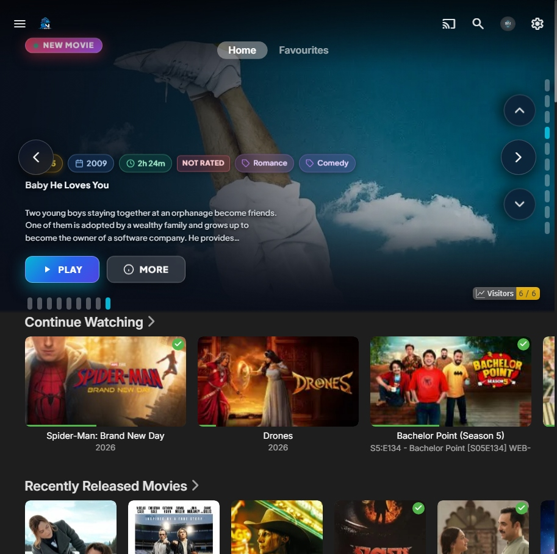

# 🌟 Emby Home Swiper V2 — Enhanced & Classic Editions

<div align="center">

[](../LICENSE)
[](https://emby.media)
[](#)

**Versatile, high-performance banner carousels for Emby Web clients, featuring community rating badges, production release years, and refined typography.**

<br/>



</div>

---

## 📌 ১. ওভারভিউ (Overview)

**Home Swiper V2** হলো Emby Web-এর জন্য অত্যন্ত জনপ্রিয় ও স্থিতিশীল হোম ব্যানার ক্যারোজেল সংস্করণ। এটি ব্যবহারকারীদের বিভিন্ন পছন্দ ও সার্ভারের পারফরম্যান্সের ওপর নির্ভর করে ৩টি বিশেষ ভ্যারিয়েন্ট অফার করে:

1. **`home-swiper.js` (Enhanced Swiper V2):**  
   সর্বাধুনিক আপগ্রেড সহ সংস্করণ — ভাইব্রেন্ট ফ্রস্টেড গ্লাস মেটাডাটা চিপস, লেফট-অ্যালাইনড লেআউট, ডুয়েল অ্যাকশন বাটন (`PLAY` ও `MORE`), এবং লাইভ কাউন্টার সাপোর্ট।

2. **`home_rating with year.js` (Classic Ratings & Year):**  
   ক্ল্যাসিক ব্যানার সংস্করণ — কমিউনিটি স্টার রেটিং (`⭐ 8.5/10`) এবং মিডিয়ার রিলিজ বছর (`📅 2024`) সরাসরি ব্যানারের উপর সুন্দরভাবে প্রদর্শন করে।

3. **`home-swiper-v1.js` (Minimalist Clean):**  
   অতিমাত্রায় হালকা ও মিনিমালিস্ট সংস্করণ — অতিরিক্ত মেটাডাটা ও ব্যাজ ছাড়া কেবল সিনেমাটিক ব্যাকড্রপ, স্বচ্ছ লোগো ও স্মুথ স্লাইডার প্রদান করে।

---

## 📂 ২. ফাইল পরিচিতি (File Reference)

```text
home-swiper-v2/
├── home-swiper.js           # 🌟 Enhanced Swiper v2 (সর্বাধুনিক ফ্রস্টেড গ্লাস মেটাডাটা ও অ্যাকশন বাটন)
├── home_rating with year.js # ⭐ Classic Swiper v2 (কমিউনিটি রেটিং ও রিলিজ বছর সহ)
├── home-swiper-v1.js        # ⚡ Clean Minimalist Swiper (সবার জন্য হালকা ও দ্রুতগতির)
└── README.md                # 📖 এই বিস্তারিত ডকুমেন্টেশন ফাইল
```

---

## 🛠️ ৩. ইনস্টলেশন নির্দেশিকা (Installation Guide)

### ধাপ ১: আপনার পছন্দের স্ক্রিপ্ট নির্বাচন করুন
উপরের ৩টি স্ক্রিপ্টের যেকোনো একটি নির্বাচন করুন এবং নাম পরিবর্তন করে `home.js` হিসেবে আপনার Emby সার্ভারের `dashboard-ui/` ফোল্ডারে রাখুন:

- **Windows:** `C:\Users\<User>\AppData\Roaming\Emby-Server\system\dashboard-ui\home.js`
- **Linux:** `/opt/emby-server/system/dashboard-ui/home.js`
- **Docker:** `/system/dashboard-ui/home.js`

### ধাপ ২: `index.html`-এ স্ক্রিপ্ট যুক্ত করা
`dashboard-ui/index.html` ফাইলটি টেক্সট এডিটরে ওপেন করে `apploader.js`-এর ঠিক পরে (বা `</body>`-এর আগে) নিচের লাইনটি ইনসার্ট করুন:

```html
<!-- Emby Home Swiper V2 -->
<script src="home.js" defer></script>
```

### ধাপ ৩: ক্যাশ রিফ্রেশ
ব্রাউজারে গিয়ে **Ctrl + F5** চেপে রিফ্রেশ করুন এবং আপনার হোম স্ক্রিনে (`#!/home`) প্রবেশ করুন।

---

## 🧩 ৪. ব্রাউজার এক্সটেনশন সেটআপ (Userscript)

ব্রাউজারে **Tampermonkey** বা **Violentmonkey** এক্সটেনশন ব্যবহার করে সরাসরি ক্লায়েন্ট সাইডে চালাতে পারেন:

```javascript
// ==UserScript==
// @name         Emby Home Swiper V2
// @namespace    https://github.com/sohag1192/Emby-Home-Swiper-UI
// @version      2.0.0
// @description  A dynamic banner carousel for Emby Web
// @match        *://*/web/index.html*
// @match        *://*/*/web/index.html*
// @require      https://raw.githubusercontent.com/sohag1192/Emby-Home-Swiper-UI/main/home-swiper-v2/home-swiper.js
// @grant        none
// ==/UserScript==
```

---

## ⚙️ ৫. কনফিগারেশন ও সেটিংস (Configuration)

স্ক্রিপ্টের মধ্যে `class HomeSwiper.start()` ফাংশন থেকে স্লাইড ট্রানজিশন ও কোয়েরি ফিল্টার পরিবর্তন করতে পারেন:

```javascript
this.itemQuery = {
    ImageTypes: "Primary,Backdrop",
    EnableImageTypes: "Primary,Backdrop,Banner,Logo",
    IncludeItemTypes: "Movie,Series", // ফিল্টার: "Movie" বা "Series"
    SortBy: "DateCreated",            // "DateCreated", "PremiereDate", "CommunityRating", বা "Random"
    SortOrder: "Descending",
    Recursive: true,
    Limit: 10,                        // মোট ব্যানার স্লাইড সংখ্যা
    Fields: "Taglines,Overview,ParentId,DateCreated,PremiereDate,ProductionYear,CommunityRating,OfficialRating,Genres,RunTimeTicks"
};

this.slideDelay = 6000;              // স্লাইড রোটেশন ডিলে (৬ সেকেন্ড)
this.showItemNum = 10;               // মোট আইটেম সংখ্যা
```

---

## 📄 ৬. লাইসেন্স ও কপিরাইট (License & Copyright)

- **Copyright (c) 2026 [sohag1192](https://github.com/sohag1192)** — All Rights Reserved.
- **GitHub Repository:** [sohag1192/Emby-Home-Swiper-UI](https://github.com/sohag1192/Emby-Home-Swiper-UI)
- **Author & Developer:** Md Sohag Rana ❤️
- **License:** [MIT License](../LICENSE)
