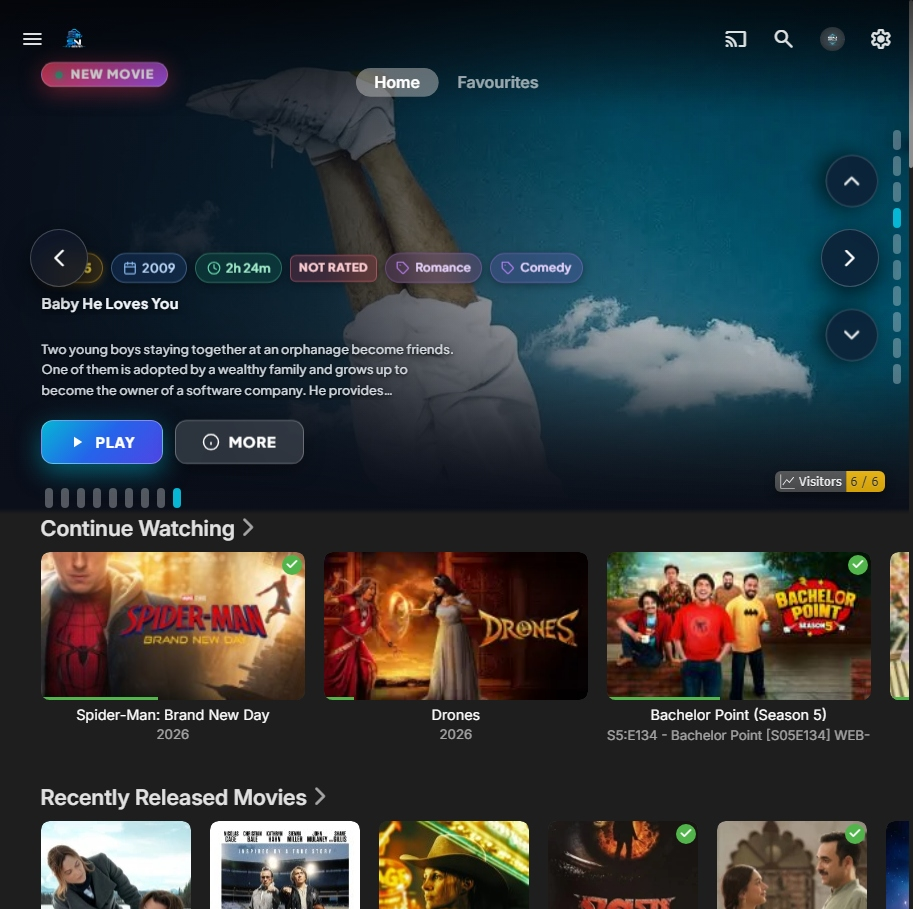

# 🚀 Emby Home Swiper V3 — Cyber-Glass Edition

<div align="center">

[](../LICENSE)
[](https://emby.media)
[](#)

**The next-generation cinematic hero banner carousel for Emby Web clients, featuring frosted acrylic Cyber-Glass HUD, pulsating status beacons, and fluid mobile responsiveness.**

<br/>



</div>

---

## 📌 ১. ওভারভিউ (Overview)

**Home Swiper V3 (Cyber-Glass Edition)** হলো Emby Web ক্লায়েন্টের জন্য একটি আধুনিক ও প্রিমিয়াম হোম ব্যানার ক্যারোজেল স্ক্রিপ্ট। এটি সার্ভারের ওয়েব ইন্টারফেসে (`#!/home`) স্বয়ংক্রিয়ভাবে লাইব্রেরির নতুন ও ট্রেন্ডিং মিডিয়াগুলোকে সিনেমাটিক ব্যাকড্রপ, ক্লিয়ার পিএনজি লোগো, কমিউনিটি রেটিং এবং ফ্রস্টেড গ্লাস মেটাডাটা চিপস সহ প্রদর্শন করে।

- **ফাইল:** [`home.js`](home.js) — প্রোডাকশন-রেডি সিঙ্গেল স্ক্রিপ্ট (Zero external dependencies).
- **কম্প্যাটিবিলিটি:** Emby Web 4.9.1.80 – 4.10.2.0+ (Chrome, Edge, Firefox, Safari, Mobile & Smart TV).

---

## ✨ ২. মূল বৈশিষ্ট্যসমূহ (Key Features)

### 💎 ক. সাইবার-গ্লাস UI ও সিনেমাটিক অ্যাম্বিয়েন্ট মাস্ক
- **Ambient Occlusion Vignette:** ৩-মুখী ডার্ক গ্রেডিয়েন্ট ট্রানজিশন যা ব্যাকড্রপ ফ্যানআর্টের স্বচ্ছতা বজায় রেখে টাইটেল ও মেটাডাটা স্পষ্ট রাখে।
- **Frosted Acrylic Glass:** আধুনিক `backdrop-filter: blur(20px)` ও নিওন সাইয়ান অ্যাকসেন্ট।
- **টপ ব্যাজ ও লাইভ পালসিং বিকন:** প্রতিটি হাইলাইটেড মুভি বা সিরিজের শীর্ষে একক **`NEW MOVIE`** ও **`NEW TV`** ব্যাজ সহ উজ্জ্বল সবুজ পালসিং স্ট্যাটাস বিকন।

### ⭐ খ. ভাইব্রেন্ট ফ্রস্টেড গ্লাস মেটাডাটা প্যালেট
- ⭐ **রেটিং ব্যাজ:** গোল্ডেন ফিল্ড স্টার (`#f59e0b`) সহ ওয়ার্ম অ্যাম্বার চিপ।
- 📅 **রিলিজ বছর:** স্লেট ক্যালেন্ডার আইকন সহ ক্রিস্প গ্লাস চিপ।
- ⏱️ **ডিউরেশন:** মিনিমালিস্ট ক্লক আইকন সহ মিনিট/ঘণ্টার সঠিক সময় প্রদর্শন।
- 🛡️ **সার্টিফিকেশন:** আন্তর্জাতিক মিডিয়া রেটিং ব্যাজ (`KR-15`, `TV-MA`, `PG-13`, `R`)।
- 🏷️ **জনরা ও ক্যাটাগরি চিপস:** সফট ফ্রস্টেড ট্যাগ চিপস (`Action`, `Comedy`, `Sci-Fi` ইত্যাদি)।

### 🎯 গ. ক্লিন সিনেমাটিক অ্যাকশন বাটনস (Play & More)
- **`PLAY` বাটন:** ভাইব্রেন্ট সায়ান-টু-ইন্ডিগো গ্রেডিয়েন্ট উইথ ৩ডি এলিভেশন ও নিয়ন শ্যাডো।
- **`MORE` বাটন:** অ্যাক্রিলিক ফ্রস্টেড গ্লাস উইথ হোভার বর্ডার গ্লো।
- ব্যানার ঘিঞ্জি হওয়া রোধ করতে অপ্রয়োজনীয় বাটন সরিয়ে নিখুঁত ২-বাটন লেআউট বজায় রাখা হয়েছে।

### 📱 ঘ. ইউনিভার্সাল লেফট-অ্যালাইনড ও মোবাইল রেসপনসিভনেস
- **বামমুখী সুবিন্যস্ত লেআউট:** মোবাইল ও ডেস্কটপ উভয় ডিভাইসেই লোগো, মেটাডাটা, ওভারভিউ এবং অ্যাকশন বাটন বামপাশে (`x: 16px`) সুবিন্যস্ত।
- **লোগো অ্যান্টি-ক্লিপিং:** `object-fit: contain` এবং `max-width: min(270px, 75vw)` নিশ্চিত করে কোনো লোগো স্ক্রিন উপচে পড়ে না।
- **স্মার্ট পারফরম্যান্স সেভার:** পেজ নিচে স্ক্রল করলে ব্যাটারি ও সিপিইউ বাঁচাতে ব্যাকগ্রাউন্ড অটো-প্লে স্বয়ংক্রিয়ভাবে পজ (Pause) হয়ে যায়।

---

## 🛠️ ৩. ইনস্টলেশন নির্দেশিকা (Installation Guide)

### ধাপ ১: `home.js` ডাউনলোড ও প্লেসমেন্ট
[`home.js`](home.js) ফাইলটি আপনার Emby সার্ভারের `dashboard-ui/` ফোল্ডারে কপি করুন:
- **Windows:** `C:\Users\<User>\AppData\Roaming\Emby-Server\system\dashboard-ui\home.js`
- **Linux:** `/opt/emby-server/system/dashboard-ui/home.js`
- **Docker:** `/system/dashboard-ui/home.js`

### ধাপ ২: `index.html`-এ স্ক্রিপ্ট ইনজেকশন
`dashboard-ui/index.html` ফাইলটি টেক্সট এডিটর দিয়ে খুলুন এবং `apploader.js`-এর ঠিক পরে (বা `</body>`-এর আগে) নিচের লাইনটি যুক্ত করুন:

```html
<!-- Emby Home Swiper V3 (Cyber-Glass Edition) -->
<script src="home.js" defer></script>
```

> [!TIP]
> স্ক্রিপ্টে `defer` অ্যাট্রিবিউট ব্যবহার করায় Emby-এর নিজস্ব `ApiClient` লোড হওয়ার পরেই এটি রান হয়, ফলে কোনো ধরনের রেইস কন্ডিশন তৈরি হয় না।

### ধাপ ৩: হার্ড রিফ্রেশ
ব্রাউজারে গিয়ে **Ctrl + F5** (ম্যাক হলে **Cmd + Shift + R**) চেপে ক্যাশ ক্লিয়ার করে রিফ্রেশ করুন এবং `#!/home` পেজে প্রবেশ করুন।

---

## 🧩 ৪. ক্লায়েন্ট-সাইড ইউজারস্ক্রিপ্ট (Tampermonkey / Violentmonkey)

সার্ভারের ফাইল সিস্টেমে রুট অ্যাক্সেস না থাকলে যেকোনো ব্রাউজারে ইউজারস্ক্রিপ্ট হিসেবে চালাতে পারেন:

```javascript
// ==UserScript==
// @name         Emby Home Swiper V3 (Cyber-Glass)
// @namespace    https://github.com/sohag1192/Emby-Home-Swiper-UI
// @version      3.0.0
// @description  Cinematic Cyber-Glass hero banner carousel for Emby Web
// @match        *://*/web/index.html*
// @match        *://*/*/web/index.html*
// @require      https://raw.githubusercontent.com/sohag1192/Emby-Home-Swiper-UI/main/home-swiper-v3/home.js
// @grant        none
// ==/UserScript==
```

---

## ⚙️ ৫. কনফিগারেশন (Configuration Options)

`home.js` ফাইলের শুরুতে `class HomeSwiper.start()` এর মধ্যে প্রয়োজনীয় সেটিংস পরিবর্তন করতে পারেন:

```javascript
this.itemQuery = {
    ImageTypes: "Primary,Backdrop",
    EnableImageTypes: "Primary,Backdrop,Banner,Logo",
    IncludeItemTypes: "Movie,Series", // ফিল্টার: শুধু মুভি বা সিরিজ
    SortBy: "DateCreated",            // সাজানোর ধরন: "DateCreated", "PremiereDate", "CommunityRating", বা "Random"
    SortOrder: "Descending",
    Recursive: true,
    Limit: 10,                        // মোট স্লাইড সংখ্যা
    Fields: "Taglines,Overview,ParentId,DateCreated,PremiereDate,ProductionYear,CommunityRating,OfficialRating,Genres,RunTimeTicks"
};

this.slideDelay = 6000;              // স্লাইড পরিবর্তনের সময় (৬০০০ = ৬ সেকেন্ড)
this.showItemNum = 10;               // ব্যানারে প্রদর্শিত আইটেম সংখ্যা
```

---

## 📄 ৬. লাইসেন্স ও কপিরাইট (License & Copyright)

- **Copyright (c) 2026 [sohag1192](https://github.com/sohag1192)** — All Rights Reserved.
- **GitHub Repository:** [sohag1192/Emby-Home-Swiper-UI](https://github.com/sohag1192/Emby-Home-Swiper-UI)
- **Author & Developer:** Md Sohag Rana ❤️
- **License:** [MIT License](../LICENSE)

---

<div align="center">

Made with ❤️ for the global Emby Community • যদি রিপোজিটরিটি আপনার কাজে লাগে তবে একটি স্টার (⭐) দিতে ভুলবেন না!

<br/>

<sub>Copyright © 2026 <b><a href="https://github.com/sohag1192">Md Sohag Rana</a></b>. All rights reserved.</sub>

</div>
